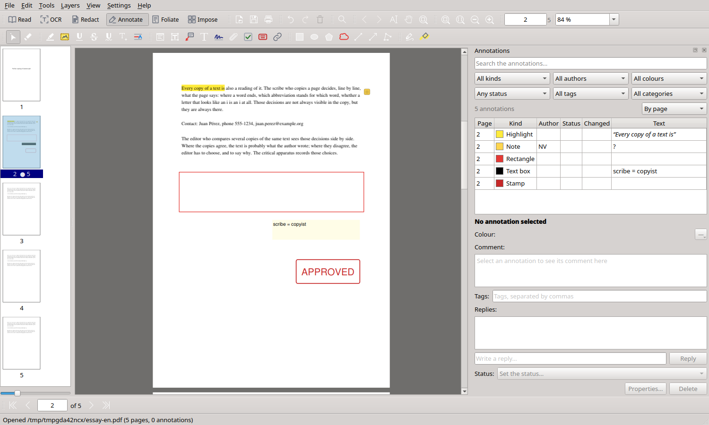
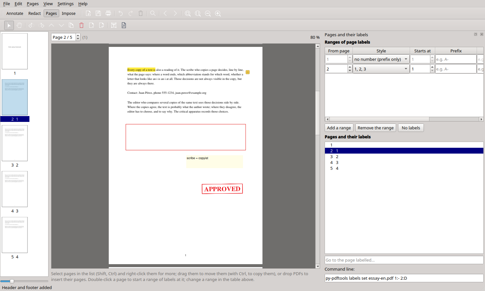

py-pdftools
===========

*(Español: [README_es.md](README_es.md))*

py-pdftools edits PDF documents. It annotates them, redacts them, changes
their page labels, headers, footers, watermarks and the order of their
pages, imposes them for printing, and reads the text of their scanned
pages. It brings together, in one window and one command line, what six
earlier programs of mine did apart:

* [py-annotate](https://github.com/nivaca/py-annotate): highlights, notes,
  text boxes, shapes, drawings and stamps, written as ordinary PDF
  annotations;
* [py-redact](https://github.com/nivaca/py-redact): boxes over what is to be
  removed, and a redacted copy in which it is removed for good, and checked;
* [py-foliation](https://github.com/nivaca/py-foliation): page labels (roman
  numbers, folios, prefixes), headers and footers with Bates numbers,
  watermarks, the view when the document is opened, and the order of the
  pages;
* [py-imposition](https://github.com/nivaca/py-imposition): booklets, n-up,
  step and repeat, bleeds and crop marks, sequences and hot folders;
* [py-pdfocr](https://github.com/nivaca/py-pdfocr): the text of scanned
  pages, read by tesseract and written into the PDF, invisible, under their
  pictures (OCR), with tesseract's languages and their more accurate
  models;
* [pdf-word-finder](https://github.com/nivaca/pdf-word-finder): on which
  pages each word, phrase or pattern of a list appears, by the numbers
  printed on them (the page labels), as lines ready for an index.

The window and the command line are in English and in Spanish. It runs on
Linux, and its installers also install it on Windows and macOS. This is
version 1.19.0.

The user manual, with pictures of the window and its dialogs, explains it
all at length: [docs/MANUAL_en.pdf](docs/MANUAL_en.pdf) (in Spanish,
[docs/MANUAL_es.pdf](docs/MANUAL_es.pdf)).

I am Nicolas Vaughan (<nicolasvaughan@proton.me>), and I wrote it in 2026.
It is free software, under the GNU General Public License, version 3 or
later (see "Licensing").

Screenshots
-----------

The mode Annotate:

The mode Redact: a box over a line, which goes on every page from the
second:

The mode Foliate: no label on the title page, then 1, 2, 3, and the label in
the footer:

The mode Impose: a booklet:

Where it comes from
-------------------

py-pdftools grew out of six programs I wrote earlier, each for one kind of
work on PDF documents. When they had grown side by side for a while, it
was clear that they shared much (the way the interface is translated, the
configuration, the conversion to PDF/A and PDF/X, the packaging) and that
the same document often went through more than one of them: annotated,
then redacted, then given its page labels, then imposed for printing. So I
brought them together. Their code was copied into py-pdftools, not used
from them: py-pdftools doesn't need them installed, and they stay as they
were, each with its own repository and releases.

    py-annotate 1.1.0      the mode Annotate; the window itself (its pages,
                           thumbnails and panels) is py-annotate's
    py-redact 1.0.9        the mode Redact
    py-foliation 1.0.1     the mode Foliate, and the commands labels, view,
                           header-footer, watermark and pages
    py-imposition 0.10.3   the mode Impose, and the commands under impose
    py-pdfocr 1.0.3        the mode OCR, and the command ocr
    pdf-word-finder 1.6    Tools > Word index, and the command find-words

What changed when they were brought together:

* One window, with a bar of modes, instead of four windows; and one
  history, so that Undo goes back through everything done to the document.
* The boxes of py-redact are now the PDF's own redaction marks: they are
  saved in the document, not applied, until the redacted copy is written.
* The changes of the mode Foliate are made at once, and shown, instead of
  waiting, as in py-foliation, until the file is saved.
* One command line, with groups: the labels of py-foliation are under
  `labels`, and every command of py-imposition under `impose`.
* One configuration folder. The settings of the old programs are not read;
  the redaction codes of py-redact (`codes.xml`) and the profiles of
  headers, footers and watermarks of py-foliation (`header-footer.json`,
  `watermark.json`) can be copied from their folders into that of
  py-pdftools (see "Settings").

A fifth program of mine came in whole:
[pdf2iso](https://github.com/nivaca/pdf2iso), which makes the copies as
PDF/A and PDF/X. It is no longer a program to install apart: the window,
the commands with `--conform`, and `py-pdftools pdf2iso`, which is pdf2iso's
own command line, all use the one in py-pdftools. Only Ghostscript, which
does the conversion, must be installed.

The documents the old programs made are read as before: the keys they wrote
in a PDF (tags and categories of annotations, layers of headers, footers
and watermarks, the history of an imposition) kept their names, and the
JSON files of annotations exported by py-annotate can be imported. How the
four were brought together, and what was found on the way, is told in
[docs/DESCRIPTION.md](docs/DESCRIPTION.md).

Installation
------------

Every version is in the [releases](https://github.com/nivaca/py-pdftools/releases),
on GitHub and on [Codeberg](https://codeberg.org/nivaca/py-pdftools/releases),
with these files:

    py-pdftools-VERSION-windows-x64-setup.exe   the installer for Windows
    py-pdftools-VERSION-macos-arm64.dmg     the disk image for macOS (Apple Silicon)
    py-pdftools-VERSION.zip                 the source, with the installers
    py-pdftools-VERSION-x86_64.AppImage     the AppImage (Linux)
    py-pdftools_VERSION-1_amd64.deb         the Debian and Ubuntu package
    py-pdftools-VERSION-1.fc45.noarch.rpm   the Fedora package, signed
    py_pdftools-VERSION.tar.gz              the source package, for Python
    py_pdftools-VERSION-py3-none-any.whl    the wheel, for Python
    FILE.asc                                the signature of each file
    SHA256SUMS, SHA256SUMS.asc              the checksums, and their signature
    SHA256SUMS-installers, and its .asc     the same, of the installers for Windows and macOS
    RPM-GPG-KEY-py-pdftools                 the key that signs them all

Every file, and the tag of the version, is signed with the same key. To
check a download, import the key once, then check the file's signature and
its checksum:

    $ gpg --import RPM-GPG-KEY-py-pdftools
    $ gpg --verify py-pdftools-VERSION.zip.asc py-pdftools-VERSION.zip
    $ gpg --verify SHA256SUMS.asc SHA256SUMS && sha256sum -c --ignore-missing SHA256SUMS

The RPM carries its signature inside too: after `sudo rpm --import
RPM-GPG-KEY-py-pdftools`, `rpm -K` checks it. The tag can be checked in a
clone with `git tag -v vVERSION`.

**Windows** 10 or later (64 bits): `py-pdftools-VERSION-windows-x64-setup.exe`
installs the program with its own Python, Qt and libraries (pyHanko among
them), for the user (or for everyone, if you choose so), with a Start-menu
entry and py-pdftools in "Open with" for PDF documents; it takes no one's
default program. It is uninstalled from Settings > Apps. The installer is
not signed by Microsoft: if SmartScreen stops it, choose *More info > Run
anyway*.

**macOS** 15 or later, on a Mac with Apple Silicon:
`py-pdftools-VERSION-macos-arm64.dmg`. Drag py-pdftools to Applications.
It is not notarized by Apple: the first time, choose *Open Anyway* in
System Settings > Privacy & Security. There is none for Macs with Intel:
PyMuPDF and pikepdf no longer publish their libraries for them.

**Fedora.** From [Copr](https://copr.fedorainfracloud.org/coprs/nivaca/py-pdftools/),
for Fedora 45 and later, with Fedora's own Python, PyMuPDF, pikepdf,
reportlab and PySide6, a menu entry and the manual (`man py-pdftools`):

    $ sudo dnf copr enable nivaca/py-pdftools
    $ sudo dnf install py-pdftools

Updates then come with `sudo dnf upgrade`. The RPM of each release can also
be installed by hand, after importing its key: `sudo rpm --import
RPM-GPG-KEY-py-pdftools`.

**Debian and Ubuntu.** The `.deb` of each release, for Debian 12, Ubuntu
22.04 and later, installs the commands `py-pdftools` and `py-pdftools-gui`,
a menu entry and the manual. Debian has no Python 3.14 yet, so the package
brings its own, with Qt and the libraries, in `/opt/py-pdftools` (as the
AppImage does):

    $ sudo apt install ./py-pdftools_*_amd64.deb

Or add, once, the APT repository of my programs
([github.com/nivaca/apt](https://github.com/nivaca/apt)), signed with the
same key; then `apt upgrade` brings each new version:

    $ sudo curl -fsSLo /usr/share/keyrings/nivaca-archive-keyring.gpg \
        https://github.com/nivaca/apt/releases/download/stable/nivaca-archive-keyring.gpg
    $ echo "deb [signed-by=/usr/share/keyrings/nivaca-archive-keyring.gpg] https://github.com/nivaca/apt/releases/download/stable ./" \
        | sudo tee /etc/apt/sources.list.d/nivaca.list
    $ sudo apt update && sudo apt install py-pdftools

**AppImage (any Linux).** It needs nothing else: it brings its own Python,
Qt and libraries, and runs with glibc 2.34 or later (Ubuntu 22.04, Debian
12, Fedora 35 and later). Make it executable and run it:

    $ chmod +x py-pdftools-*-x86_64.AppImage
    $ ./py-pdftools-*-x86_64.AppImage [file.pdf]                 the window
    $ ./py-pdftools-*-x86_64.AppImage impose booklet book.pdf    a command

**With the installers (Linux, macOS, Windows).** They need Python 3.14 or
later. From the folder of the source:

    $ install/install.sh                Linux and macOS: install, or update
    $ install/install.sh --uninstall
    > install\install.bat               Windows: install, or update
    > install\install.bat -Desktop      also a shortcut on the desktop
    > install\install.bat -Uninstall

On Windows the options can also be written as for install.sh (`--uninstall`,
`--desktop`, `--python C:\...\python.exe`), and `install.ps1` can be run
instead of `install.bat`.

Each one makes a Python environment of its own for py-pdftools, installs it
there with PyMuPDF, pikepdf, reportlab and PySide6 (downloaded from PyPI, so
it needs internet the first time), links the commands `py-pdftools` and
`py-pdftools-gui`, and adds the window to the menu of the system. On macOS
this is `~/Applications/py-pdftools.app`, which the Finder also offers for
PDFs (Open With); the documents opened from there, or dropped on its icon
in the Dock, go to the program already running. Nothing needs
administrator rights, and the settings are never touched.

**From the source**, with [uv](https://docs.astral.sh/uv/):

    $ git clone https://github.com/nivaca/py-pdftools.git
    $ cd py-pdftools
    $ uv run py-pdftools-gui [file.pdf]       the window
    $ uv run py-pdftools --help               the command line

Copies as PDF/A or PDF/X need Ghostscript, which makes them (pdf2iso, which
prepares and checks them, is part of py-pdftools: see "Where it comes
from"). For OCR, the tesseract program, with the languages of the
documents (`tesseract-langpack-…` on Fedora, `tesseract-ocr-…` on Debian
and Ubuntu).
Digital signatures need pyHanko: the AppImage and the installers bring it;
elsewhere, `pip install 'py-pdftools[signatures]'`. Fedora doesn't package
it: with the RPM, `python3 -m pip install --user pyhanko` installs it in
your own packages, where the program looks for it.
Reading aloud (View > Read aloud) needs Qt's QtTextToSpeech, which the
PySide6 of Fedora and the other distributions brings, with a voice of
the system (speech-dispatcher, on Linux); installed with pip,
`pip install 'py-pdftools[speech]'` adds it (PySide6-Addons, which is
large). The AppImage and the installers don't bring it.

The window
----------

A document is opened with File > Open, or dropped on the window. Its pages
are shown one under the other, with their thumbnails on the left. The bar
of modes, at the top (or Ctrl+1 to Ctrl+6), chooses what the window does,
and how it is arranged:

* **Read**: only the pages and their thumbnails, with the toolbars to open,
  find, move through the pages and zoom; the mouse moves the pages;
* **OCR**: the text of scanned pages, read by tesseract; its panel chooses
  the pages, the languages and how to read them (see below);
* **Redact**: the tool Redact (dragging over text marks it; elsewhere, or
  with Ctrl, it draws a box), Find and redact, redaction codes, and the
  panel of the boxes;
* **Annotate**: the tools of py-annotate, in the second toolbar and the
  menu Annotate; the panel of the annotations on the right, which can be
  searched, filtered and sorted; stamps of one's own, made of a picture or
  of a page of a PDF (a seal, a logo), in the Stamp tool's right-click
  menu, with the standard ones;
* **Foliate**: the ranges of labels and the list of the pages with their
  labels, on the right; the actions on the pages chosen in the toolbar and
  in their right-click menu; headers and footers, watermarks and the view
  when the document is opened, in the menu Pages;
* **Impose**: py-imposition's workspace, with its basic form, the forms of
  every command, the sequence and the log, in place of the pages.

Each mode keeps its own arrangement of the window: which toolbars and
panels are shown, where they are, the thumbnails and the width of the
pages beside them. Arrange a mode once (drag its toolbars and panels,
hide them with a right click on them) and choosing it again brings that
arrangement back, also the next time the program is opened.

The tool Select text (X), beside Hand in every mode, selects text as in a
text editor: drag over it (across pages too), Alt+drag for a column,
double-click a word, triple-click a line, Shift+click to extend. Ctrl+C
copies it, Ctrl+Shift+C copies it without its line breaks, Ctrl+A selects the text of the page, and a right click offers
to highlight, underline or strike it out, to mark it for redaction, or to
find it.

Settings > General > Keep running in the background makes documents open
faster: when the last window is closed, py-pdftools goes on running, with
its pages ready to be drawn and an icon in the tray (where the desktop has
one), and py-pdftools-gui started again opens its files in it, at once.
File > Quit ends it. A window is kept ready, hidden, for the next document,
which then opens in a few hundredths of a second. `py-pdftools-gui
--no-tray` starts a program of its own this time, whatever the setting says:
not in the background, not handing its files to the one running, and ended
with its last window (to try a version from the source, `uv run
py-pdftools-gui --no-tray`, beside the one installed). With Settings > General >
Start with the session, py-pdftools starts when you log in, in the tray and
without a window (`py-pdftools-gui --background`), so that the first
document of the day opens at once too. On Windows this setting is a value
in the key Run of the user's registry; on macOS it is a launch agent, the
icon is in the menu bar (in black, as the others there), and a click on the
icon of the Dock, with no window open, opens one.

Settings > Performance sets how much memory the window may use (Low,
Normal, High, or All pages, which keeps every page and thumbnail drawn,
within half of the free memory), whether selections are drawn with
transparency or as outlines, whether text and graphics are smoothed
(antialiasing), and whether the pages are drawn with the graphics card
(OpenGL, off at first, from the next start), which makes scrolling and
zooming smoother.

Moving through a document works in every mode; the thumbnails are shown or
hidden with F7. Find > Find as you type (Ctrl+F or /) brings down a small
panel over the top of the pages that searches at every letter typed,
highlights every place found and goes from one to the next with Enter, or
F3 (Shift+F3, back) from anywhere in the window; capitals and accents count
only if asked. It is instantaneous: it stops at the first place found and
counts the others afterwards. Find > Find and highlight (Ctrl+Shift+F) is
the search with every option.
Settings > Toolbars > Reset the toolbars puts every toolbar back as it was
at first, in every mode; the panels stay where they are.
View > Panels > Search results (F8) lists every place of a text, with its page
and the words around it, and goes to each with a click. View > Panels >
Attached files (F9) lists the files attached to the document or to its pages,
to open, save, add or remove them. View > Bookmarks (F5)
shows the document's bookmarks (hidden until it is asked for) as a tree that can be filtered; its right
click adds, renames, moves, indents and styles them, or makes them from
the headings; Ctrl+B adds one at the place shown, and View > Go to has the
next and the previous bookmark. Links are followed with a click (with Select, Ctrl+click),
web and mail addresses written in the text too, and Alt+Left and
Alt+Right go back and forth through the places jumped to. A document
opens where it was left, or as it asks (its page, zoom and thumbnails), and
`py-pdftools-gui book.pdf#page=12` or `#nameddest=intro` opens it at a
place. The menu View has two pages side by side (Ctrl+Shift+2, with the
first alone as a cover if wished), the zooms (fit the page, the width, the
height, or the inked area; actual size; a percentage typed in the box of
the zoom, from 5 % to 10000 %; the tool Zoom to area, Z; and the tool Magnifier, Shift+Z,
a lens that shows the part of the page under the pointer three times nearer), the view turned without changing
the file (Ctrl+] and Ctrl+[), reading colours (white, yellow or green on
black, or one's own), the gaps between the pages hidden, the margins trimmed (only the
inked part of each page), and Full screen
(F11) as a presentation, where B makes the screen black. File > Open in a new tab (Ctrl+T) puts documents
in tabs of one window (the tabbar shows from the second one on,
or always, with a setting), and View > Split the view (`Ctrl+\`) shows two
side by side. Ctrl+Shift+T reopens the last tab closed, and Alt+Shift+1 to 9
go to a tab (9, the last). A document changed by another program opens again by itself.
Left and Right go to the previous and next page (while the pages fit across
the view). Space held turns any tool into Hand, and the middle button scrolls by
itself. The toolbar Page navigation, at the top between Navigation and Zoom, goes to
the first, previous, next and last page, and its box takes a page number
or label; like the other toolbars, it can be changed in Customize the
toolbars. The box of the zoom is on the toolbar Zoom box, which can be moved
anywhere or hidden. File > Document properties
shows what a document is (its metadata, file, pages, security) and the
fonts it uses. Tools > Compare > Compare visually shows this document and
another PDF page by page, side by side with what differs framed, or one over
the other (this one red, the other blue, black where they agree), and goes
from one page that differs to the next.

Tools > Word index (from pdf-word-finder; also a button on the toolbar
Find) finds the words, phrases or
regular expressions of a list, typed or read from a file, and gives the
pages where each appears, by their labels, as lines ready for the index of
a book (`Sharahzad 3, 5, 23, 34`), or in detail, with how many times and
a fragment of text around each place; the result is copied, or saved as
text or CSV. Words split by a hyphen at the end of a line are joined
first, and accents can be ignored. From the command line:
`py-pdftools find-words book.pdf --words-file terms.txt --txt index.txt`.

Redact > Find covered text looks for text that only seems redacted:
still in the file under a black or white box, a picture or an annotation
drawn over it, where anyone can copy it; boxes put over what it finds take
it out in the redacted copy. Remove hidden information also takes out the
layers switched off, with what they hold. File > Protect with passwords
sets a password to open the document, one for its permissions (printing,
copying, changing it), or both, encrypted with AES-256; only the
permissions password changes or removes them. Settings > Toolbars sets how the toolbars look, as in KDE: the
position of their text (icons only, text only, beside or under the icons),
the size of their icons, and whether they stay where they are; the right
click on any toolbar sets them for all of them. Customize the toolbars chooses
the buttons of each toolbar and their order, with separators and spacers,
and adds toolbars of one's own. The toolbars of a row stay side by side,
without the empty spaces a drag would leave; a spacer makes one where it is
wanted. The menus File, Edit and View are in submenus (File > New, Export,
Import, Security; View > Panels, Go to, Zoom, Page layout...).

File > Combine files makes one PDF of several, or of some of their pages
in an order (`1-3, 7`), with their links, annotations, form fields and
bookmarks; the files are dropped on its list or added, and put in order
by dragging them. File > New PDF from images makes a PDF of photographs
or scans, a page for each, as big as each picture or on paper with a
margin, and can open it in the mode OCR to read its text. From the
command line: `py-pdftools combine a.pdf b.pdf:2-5 -o all.pdf` and
`py-pdftools from-images *.jpg -o scans.pdf --paper A4`.

File > Export saves the pages as pictures (PNG, JPEG or TIFF, at a
resolution, in grey if wished), the pictures of the document, or its text
(Text (Markdown), with its headings guessed, or Text (plain, UTF-8); HTML
too), and the annotations as a report in Markdown or in plain text; File > Save a
copy > As another PDF version makes a copy that says it is PDF 1.3 to
2.0, naming what the document uses that the version chosen doesn't have.
Pages > Arrange pages > Split cuts a document every so many pages (one per
page, named after their labels), at given pages, at its bookmarks (each
part named after its bookmark), or so that no part is bigger than a size.
From the command line: `py-pdftools export pages | images | text`,
`py-pdftools pdf-version`, and `py-pdftools pages --split-bookmarks 1` or
`--split-size 10`.

Tools > Page sorter (Ctrl+Alt+G) shows every page in a grid of large
thumbnails, to put a long document in order by dragging its pages, several
at once, and to turn, duplicate or delete them; OK makes it all as one
change, which Undo takes back at once.

Tools > Run steps on several files does the same work on many PDFs: some
of OCR, a header or footer, a watermark, a smaller size and PDF/A, ticked
and put in order, on each file of a list; the results go to a folder,
never over the originals, and the steps can be kept as recipes.

File > Save a copy > Reduced file size makes a copy that takes less space: its
pictures drawn again at a lower resolution (only those shown above it),
its fonts reduced to the characters used, what nothing uses taken out;
the dialog shows where the bytes go. File > Save a copy > With pages as
pictures turns some pages, or all, into pictures of themselves: they look
the same, but their text can no longer be found, copied or extracted
(`py-pdftools rasterize` does it from the command line). The tool Link (J, in Annotate) draws
a link to a page, an address or another PDF, and a click on a link changes
or removes it; Edit > Links makes links of the addresses in the text.

Forms are filled in the panel Form fields (F6), which opens by itself with a
document that has one, or with clicks on the page. What most forms ask is
done without JavaScript: numbers and dates checked and shown in their
format, sums worked out. The panel exports and imports the values (JSON,
CSV, XFDF, FDF), and `py-pdftools form` shows, fills, tabulates and
flattens forms from the command line. File > Security signs the
document with a digital ID, visibly or not (and makes an ID of one's own),
and checks its signatures: whether each is intact and valid, who signed
and whether they are trusted, and what changed after it.

Help > Tips for this mode (F1) shows, over the bottom of the pages, a hint
on what can be done in the mode chosen; Settings > Appearance can show it
whenever a mode is chosen, and can turn on the tooltips (both are off at
first). The tooltips of the toolbars show always. Help > Find a command
(Ctrl+Shift+P, or Ctrl+Alt+I) finds any command of the menus by any word of its name or of its
place in them, and runs it. View > Next panel (Ctrl+F6) takes the keyboard to
the thumbnails, the pages and each panel in turn, and every field and list has
a name for screen readers.

The mode OCR (Ctrl+Shift+O, or its button Recognise text) reads the text of
scanned pages with tesseract and writes it into the document, invisible, under their
pictures, so that it can be found, copied and marked; it is a change of
the document, undone and saved like the others. It reads the scanned
pages, those chosen in the thumbnails or a list of them, in the languages
ticked in its panel (the main one first), and can turn first the pages scanned sideways or upside down.
The words tesseract was not sure of are shown beside their pictures, to
be corrected before the text is written (how sure is sure enough is set in
the panel). OCR > Languages lists every language tesseract can read, and
downloads, updates or removes its more accurate models (tessdata_best), and
osd, which finds how pages are turned (this needs the internet, once). To
download several at once, tick them: the languages ticked make a list,
shown under the table, which Download takes one after another. In
the other modes, the menu of the thumbnails reads the pages chosen. From the
command line: `py-pdftools ocr scan.pdf -l lat+spa --rotate --report`.

Each mode works on its own annotations: in Annotate, the redaction boxes are
shown, but the mouse goes through them, and in Redact the annotations are.
Undo goes back through everything done to the document, in any mode.
View > Panels > History (F10) lists those steps, each said in a few words;
a click on one undoes or redoes everything up to it.

**Saving.** File > Save writes the document: its annotations, its redaction
boxes (as the PDF's redaction marks, not yet applied), and the changes of
the modes Foliate and Impose. Those changes are made at once on a working
copy, and shown, but the file stays as it was until it is saved.

**Redacting.** Nothing under the boxes is removed until the redacted copy is
written, with Redact > Save redacted copy (Ctrl+Shift+R): a new file,
never the one open, in which what is under the boxes is removed for good.
It is checked as it is written: if any text under a box can still be read,
or a bookmark gives it away, the window says so. The copy is made from the
document as it was last saved, so the window offers to save the other
changes first. Copies that make the annotations part of the pages
(flattened, searchable, printed) leave the boxes out, since a box painted
there would hide what is still in the file.

**Imposing.** The mode Impose imposes the document as it is in the window.
Preview runs the command and shows the result; Save writes the result as a
new file; Apply makes the result the document (Undo takes it back).

The command line
----------------

    $ py-pdftools labels set book.pdf 1:r 9:D -i       i, ii ... from page 1; 1, 2 ... from page 9
    $ py-pdftools labels book.pdf                      the labels of a file
    $ py-pdftools header-footer book.pdf --footer-center 'Page $pagelabel' -i
    $ py-pdftools watermark book.pdf --text DRAFT --opacity 30% -i
    $ py-pdftools pages book.pdf --move 201-214 9 --delete LAST -i
    $ py-pdftools view book.pdf --layout cover --open-at 9 -i
    $ py-pdftools impose booklet book.pdf -o booklet.pdf
    $ py-pdftools impose --help                        the commands of imposition
    $ py-pdftools find-words book.pdf amor "re:virtu(s|tem|tis)" --sort
                                                       the pages of each term

`py-pdftools COMMAND -h` explains each command. `py-pdftools completion
bash|fish|zsh` prints a completion script for the shell. The commands are
those of py-foliation and py-imposition, which their READMEs explain at
length; `labels` holds py-foliation's `show`, `set`, `clear` and `copy`.

Settings
--------

The language of the interface is chosen in Settings > Language (or
Settings > Appearance), or with `py-pdftools interface es`. Settings >
Appearance also sets the colours of the interface (as the system, light,
dark or high contrast), its size, how sharp the text of the pages is drawn, the hints shown when a mode is chosen, and how the
toolbars look; Settings > Documents, how a document opened for the first
time is shown, whether each opens where it was left, whether to ask before
opening a web address, how many recent documents File > Open recent shows,
and where the file dialogs start. The settings are kept in a file, `config.toml`,
in the user's configuration folder: `~/.config/py-pdftools/` on Linux,
`~/Library/Application Support/py-pdftools/` on macOS, `%APPDATA%\py-pdftools\`
on Windows (or the folder `$PY_PDFTOOLS_CONFIG` names). What the window
keeps of itself (its size, the arrangement of each mode, the toolbars, the
documents open at the end) goes in the same file, after the settings, in
the tables `[window]` and `[impose]`; older versions kept it in a second
file, `py-pdftools.conf`, which is moved into `config.toml` at the first
start. Each setting is checked when it is read, so a file edited by hand
can't stop the program. Help > Reset all settings puts them all back to
their usual values, after asking: every window closes, `config.toml` is
moved aside as a dated copy (`config-YYYY-MM-DD-HHMMSS.toml`, beside it)
and the program ends; stamps, signatures, digital IDs, recipes and
profiles are not touched.
Help > System check (also a button at the foot of Settings) lists what py-pdftools needs
and whether it has it (Python and its libraries, pyHanko, tesseract and the
OCR languages chosen, Ghostscript, the space of the temporary folder),
which settings in the file aren't valid or known, and shortcuts used twice;
each with what to do, and a report that can be copied.
Help > Check for updates asks GitHub for the latest release (only
then: the program never asks by itself, and sends nothing about the user)
and, if there is a newer one, says how to install it for the way this copy
was installed (`dnf upgrade` for the RPM, the new `.deb` or AppImage, the
installers again, `git pull`, or the wheel with pip), with a button that
opens the page of the release.

Tests
-----

    $ uv run python tools/test.py

runs every file of tests in a process of its own, as many at once as the
computer has processors, the slowest first: the whole suite takes about as
long as its slowest file (some twenty seconds, instead of over a minute).
`-v` shows each file as it ends, and names (`test_findbar`, `pages`) run only
those. `uv run pytest` runs them one after the other, as before.

There are 744 tests: those of the four programs, and those of what is new
(the command line as a whole, the modes of the window, the redaction boxes,
the working copies, OCR, navigation, security, the menus and toolbars,
combining files and PDFs of pictures, smaller copies, links, forms,
signatures, exports, splitting, the PDF version, the Spanish interface, the
packaging). Their
windows are drawn on an X server of their own (Xvfb), if it is installed,
else offscreen; `PY_PDFTOOLS_TEST_DISPLAY=offscreen` or `=screen` (to
watch them on the desktop) choose otherwise. See
[docs/DESCRIPTION.md](docs/DESCRIPTION.md) for how the program was made.

Code signing policy
-------------------

Free code signing provided by [SignPath.io](https://about.signpath.io),
certificate by [SignPath Foundation](https://signpath.org). The installer
for Windows is signed with Authenticode, and only when GitHub builds it from
this repository; every signing is approved by hand. What is signed, the
team roles and the privacy policy (the program goes to the internet only
when one asks it to: to check for updates, or to download OCR models) are
in [CODE_SIGNING_POLICY.md](CODE_SIGNING_POLICY.md).

Licensing
---------

py-pdftools is free software: you can redistribute it and/or modify it
under the terms of the GNU General Public License as published by the Free
Software Foundation, either version 3 of the License, or (at your option)
any later version (see [LICENSE](LICENSE)). It uses PyMuPDF (GNU AGPL 3),
pikepdf (Mozilla Public License 2.0), reportlab (BSD) and PySide6 (GNU LGPL
3). All the open-source software it uses, with its licences, is listed in
[docs/THIRD-PARTY.md](docs/THIRD-PARTY.md).
