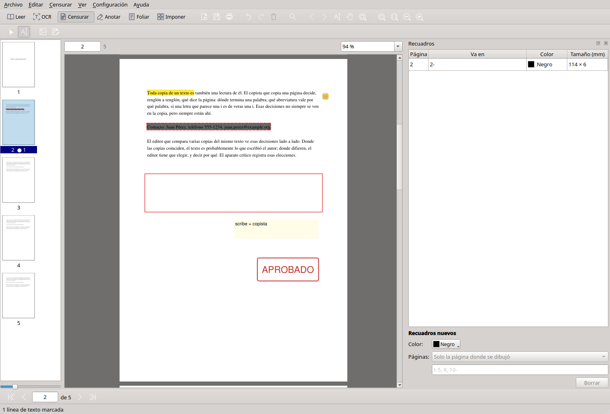
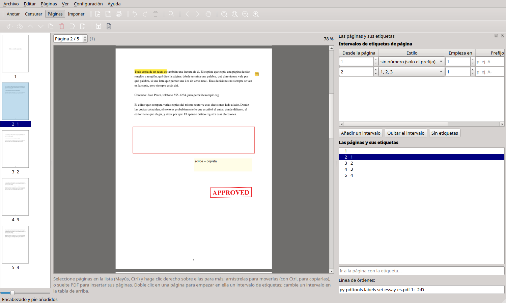

py-pdftools
===========

*(English: [README.md](README.md))*

py-pdftools edita documentos PDF. Los anota, los censura, cambia sus
etiquetas de página, sus encabezados, pies de página y marcas de agua y el
orden de sus páginas, y los impone para imprenta. Reúne, en una sola
ventana y una sola línea de órdenes, lo que hacían por separado cuatro
programas anteriores míos:

* [py-annotate](https://github.com/nivaca/py-annotate): resaltados, notas,
  cuadros de texto, formas, dibujos y sellos, escritos como anotaciones PDF
  corrientes;
* [py-redact](https://github.com/nivaca/py-redact): recuadros sobre lo que
  debe quitarse, y una copia censurada en la que se elimina para siempre, y
  se comprueba;
* [py-foliation](https://github.com/nivaca/py-foliation): etiquetas de
  página (números romanos, folios, prefijos), encabezados y pies con números
  Bates, marcas de agua, la vista al abrir el documento y el orden de las
  páginas;
* [py-imposition](https://github.com/nivaca/py-imposition): folletos, n-up,
  paso y repetición, sangrados y marcas de corte, secuencias y carpetas
  vigiladas.

La ventana y la línea de órdenes están en español y en inglés. Funciona en
Linux, y sus instaladores lo instalan también en Windows y macOS. Esta es la
versión 0.1.0.

Soy Nicolas Vaughan (<nicolasvaughan@proton.me>) y lo escribí en 2026. Es
software libre, bajo la Licencia Pública General de GNU, versión 3 o
posterior (véase «Licencia»).

Capturas de pantalla
--------------------

El modo Anotar:

El modo Censurar: un recuadro sobre un renglón, que va en todas las páginas
desde la segunda:

El modo Páginas: la portada sin etiqueta, luego 1, 2, 3, y la etiqueta en
el pie de página:

El modo Imponer: un folleto:

Instalación
-----------

Desde la primera versión publicada, cada versión estará en las
publicaciones, en GitHub y en Codeberg, con el código (con los
instaladores), la AppImage, el paquete de Fedora firmado, la rueda y el
paquete fuente. Hasta entonces, se instala desde el código.

**Con los instaladores (Linux, macOS, Windows).** Necesitan Python 3.14 o
posterior. Desde la carpeta del código:

    $ install/install.sh                Linux y macOS: instalar, o actualizar
    $ install/install.sh --uninstall
    > install\install.bat               Windows: instalar, o actualizar
    > install\install.bat -Desktop      también un acceso en el escritorio
    > install\install.bat -Uninstall

Cada uno hace un entorno de Python propio para py-pdftools, lo instala en él
con PyMuPDF, pikepdf, reportlab y PySide6 (descargados de PyPI, así que la
primera vez necesita internet), enlaza las órdenes `py-pdftools` y
`py-pdftools-gui` y añade la ventana al menú del sistema. Nada necesita
permisos de administrador, y la configuración nunca se toca.

**Desde el código**, con [uv](https://docs.astral.sh/uv/):

    $ git clone https://github.com/nivaca/py-pdftools.git
    $ cd py-pdftools
    $ uv run py-pdftools-gui [archivo.pdf]    la ventana
    $ uv run py-pdftools --help               la línea de órdenes

**AppImage y RPM.** `tools/bundle-appimage.py` hace una AppImage, que lleva
su propio Python y sus bibliotecas y funciona en cualquier Linux con glibc
2.34 o posterior; abre la ventana, o la línea de órdenes si se le da una
orden (`py-pdftools.AppImage impose booklet libro.pdf`).
`packaging/build-rpm.sh` hace el RPM para Fedora, con el Python, el
PyMuPDF, el pikepdf y el PySide6 de Fedora, una entrada en el menú y el
manual (`man py-pdftools`).

Para guardar copias como PDF/A o PDF/X hace falta además
[pdf2iso](https://github.com/nivaca/pdf2iso), con Ghostscript. Para las
copias con texto buscable de páginas escaneadas, Tesseract.

La ventana
----------

Un documento se abre con Archivo > Abrir, o soltándolo sobre la ventana. Sus
páginas se ven una debajo de otra, con sus miniaturas a la izquierda. La
barra de modos, arriba (o Ctrl+1 a Ctrl+4), elige qué hace la ventana:

* **Anotar**: las herramientas de py-annotate, en la segunda barra y en el
  menú Herramientas; el panel de las anotaciones a la derecha, que se puede
  buscar, filtrar y ordenar;
* **Censurar**: la herramienta Censurar (arrastrar sobre un texto lo marca;
  en otra parte, o con Ctrl, dibuja un recuadro), Buscar y censurar, los
  códigos de censura y el panel de los recuadros;
* **Páginas**: los intervalos de etiquetas y la lista de las páginas con sus
  etiquetas, a la derecha; las acciones sobre las páginas elegidas, en la
  barra y en su menú del botón derecho; los encabezados y pies, las marcas
  de agua y la vista al abrir el documento, en el menú Páginas;
* **Imponer**: el espacio de trabajo de py-imposition, con su formulario
  básico, los formularios de cada orden, la secuencia y el registro, en
  lugar de las páginas.

Cada modo trabaja sobre sus propias anotaciones: en Anotar, los recuadros de
censura se ven, pero el ratón los atraviesa, y en Censurar, las anotaciones.
Deshacer recorre todo lo que se hizo al documento, en cualquier modo.

**Guardar.** Archivo > Guardar escribe el documento: sus anotaciones, sus
recuadros de censura (como marcas de redacción del PDF, todavía sin
aplicar) y los cambios de los modos Páginas e Imponer. Esos cambios se
hacen en el acto sobre una copia de trabajo, y se ven, pero el archivo
queda como estaba hasta que se guarda.

**Censurar.** Nada de lo que hay debajo de los recuadros se elimina hasta
que se escribe la copia censurada, con Censurar > Guardar la copia
censurada (Ctrl+Mayús+R): un archivo nuevo, nunca el que está abierto, en el
que lo que hay debajo de los recuadros desaparece para siempre. Se
comprueba al escribirlo: si algún texto debajo de un recuadro todavía puede
leerse, o un marcador lo delata, la ventana lo dice. La copia se hace a
partir del documento tal como se guardó por última vez, así que la ventana
ofrece guardar antes los otros cambios. Las copias que vuelven las
anotaciones parte de las páginas (aplanadas, buscables, impresas) dejan
fuera los recuadros, porque un recuadro pintado ahí taparía lo que sigue en
el archivo.

**Imponer.** El modo Imponer impone el documento tal como está en la
ventana. Vista previa ejecuta la orden y muestra el resultado; Guardar lo
escribe como un archivo nuevo; Aplicar convierte el resultado en el
documento (Deshacer lo revierte).

La línea de órdenes
-------------------

    $ py-pdftools labels set libro.pdf 1:r 9:D -i     i, ii ... desde la página 1; 1, 2 ... desde la 9
    $ py-pdftools labels libro.pdf                     las etiquetas de un archivo
    $ py-pdftools header-footer libro.pdf --footer-center 'Página $pagelabel' -i
    $ py-pdftools watermark libro.pdf --text BORRADOR --opacity 30% -i
    $ py-pdftools pages libro.pdf --move 201-214 9 --delete LAST -i
    $ py-pdftools view libro.pdf --layout cover --open-at 9 -i
    $ py-pdftools impose booklet libro.pdf -o folleto.pdf
    $ py-pdftools impose --help                        las órdenes de la imposición

`py-pdftools ORDEN -h` explica cada orden. `py-pdftools completion
bash|fish|zsh` imprime el script de completado del shell. Las órdenes son
las de py-foliation y py-imposition, que sus README explican con detalle;
`labels` reúne `show`, `set`, `clear` y `copy` de py-foliation.

Configuración
-------------

El idioma de la interfaz se elige en Configuración > Idioma, o con
`py-pdftools interface es`. La configuración se guarda en un archivo,
`config.toml`, en la carpeta de configuración del usuario:
`~/.config/py-pdftools/` en Linux, `~/Library/Application Support/py-pdftools/`
en macOS y `%APPDATA%\py-pdftools\` en Windows (o la carpeta que diga
`$PY_PDFTOOLS_CONFIG`). Cada ajuste se comprueba al leerlo, de modo que un
archivo editado a mano no puede detener el programa.

Pruebas
-------

    $ uv run pytest

Hay 399 pruebas: las de los cuatro programas, y las de lo nuevo (la línea de
órdenes entera, los modos de la ventana, los recuadros de censura, las
copias de trabajo, la interfaz en español, el empaquetado). Cómo se hizo el
programa está en [docs/DESCRIPCIÓN_es.md](docs/DESCRIPCIÓN_es.md).

Licencia
--------

py-pdftools es software libre: puede redistribuirlo o modificarlo según los
términos de la Licencia Pública General de GNU publicada por la Free
Software Foundation, versión 3 o (a su elección) cualquier versión
posterior (véase [LICENSE](LICENSE)). Usa PyMuPDF (GNU AGPL 3), pikepdf
(Mozilla Public License 2.0), reportlab (BSD) y PySide6 (GNU LGPL 3).
