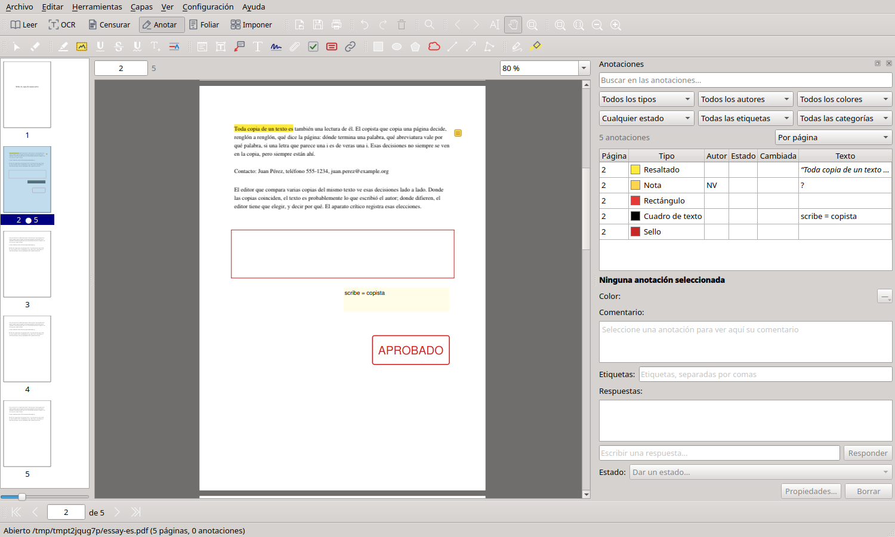
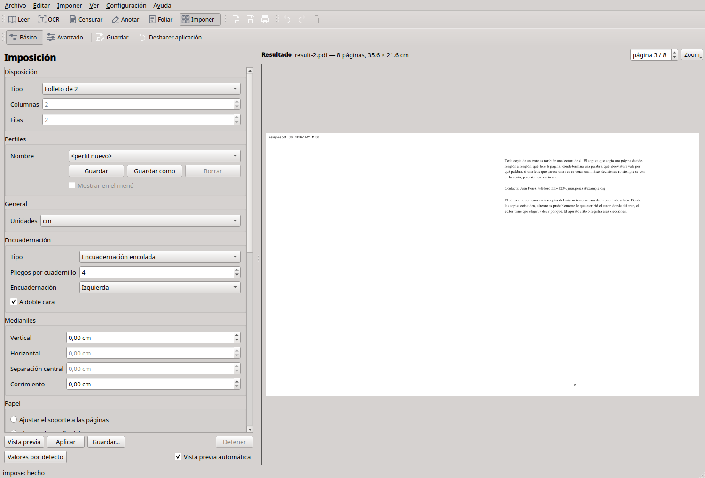

py-pdftools
===========

*(English: [README.md](README.md))*

py-pdftools edita documentos PDF. Los anota, los censura, cambia sus
etiquetas de página, sus encabezados, pies de página y marcas de agua y el
orden de sus páginas, los impone para imprenta y lee el texto de sus
páginas escaneadas. Reúne, en una sola ventana y una sola línea de
órdenes, lo que hacían por separado seis programas anteriores míos:

* [py-annotate](https://github.com/nivaca/py-annotate): resaltados, notas,
  cuadros de texto, formas, dibujos y sellos, escritos como anotaciones PDF
  corrientes;
* [py-redact](https://github.com/nivaca/py-redact): recuadros sobre lo que
  debe quitarse, y una copia censurada en la que se elimina para siempre, y
  se comprueba;
* [py-foliation](https://github.com/nivaca/py-foliation): etiquetas de
  página (números romanos, folios, prefijos), encabezados y pies con números
  Bates, marcas de agua, la vista al abrir el documento y el orden de las
  páginas;
* [py-imposition](https://github.com/nivaca/py-imposition): folletos, n-up,
  paso y repetición, sangrados y marcas de corte, secuencias y carpetas
  vigiladas;
* [py-pdfocr](https://github.com/nivaca/py-pdfocr): el texto de las páginas
  escaneadas, leído por tesseract y escrito en el PDF, invisible, bajo sus
  imágenes (OCR), con los idiomas de tesseract y sus modelos más precisos;
* [pdf-word-finder](https://github.com/nivaca/pdf-word-finder): en qué
  páginas aparece cada palabra, frase o patrón de una lista, según el
  número impreso en ellas (sus etiquetas), en renglones listos para un
  índice.

La ventana y la línea de órdenes están en español y en inglés. Funciona en
Linux, y sus instaladores lo instalan también en Windows y macOS. Esta es la
versión 1.8.3.

El manual de usuario, con imágenes de la ventana y de sus diálogos, lo
explica todo por extenso: [docs/MANUAL_es.pdf](docs/MANUAL_es.pdf) (en
inglés, [docs/MANUAL_en.pdf](docs/MANUAL_en.pdf)).

Soy Nicolas Vaughan (<nicolasvaughan@proton.me>) y lo escribí en 2026. Es
software libre, bajo la Licencia Pública General de GNU, versión 3 o
posterior (véase «Licencia»).

Capturas de pantalla
--------------------

El modo Anotar:

El modo Censurar: un recuadro sobre un renglón, que va en todas las páginas
desde la segunda:

El modo Foliar: la portada sin etiqueta, luego 1, 2, 3, y la etiqueta en
el pie de página:

El modo Imponer: un folleto:

De dónde viene
--------------

py-pdftools nació de seis programas que escribí antes, cada uno para un
tipo de trabajo con documentos PDF. Tras un tiempo de crecer uno al lado
del otro, era claro que compartían mucho (la manera de traducir la
interfaz, la configuración, el paso a PDF/A y PDF/X, el empaquetado) y que
un mismo documento solía pasar por más de uno: se anotaba, luego se
censuraba, luego recibía sus etiquetas de página y por último se imponía
para imprenta. Así que los reuní. Su código se copió en py-pdftools, no se
usa desde ellos: py-pdftools no necesita que estén instalados, y ellos
quedan como estaban, cada uno con su repositorio y sus versiones.

    py-annotate 1.1.0      el modo Anotar; la ventana misma (sus páginas,
                           miniaturas y paneles) es la de py-annotate
    py-redact 1.0.9        el modo Censurar
    py-foliation 1.0.1     el modo Foliar, y las órdenes labels, view,
                           header-footer, watermark y pages
    py-imposition 0.10.3   el modo Imponer, y las órdenes de impose
    py-pdfocr 1.0.3        el modo OCR, y la orden ocr
    pdf-word-finder 1.6    Herramientas > Índice de palabras, y la orden find-words

Lo que cambió al reunirlos:

* Una sola ventana, con una barra de modos, en lugar de cuatro; y un solo
  historial, de modo que Deshacer recorre todo lo que se hizo al documento.
* Los recuadros de py-redact son ahora las marcas de redacción del propio
  PDF: se guardan en el documento, sin aplicar, hasta que se escribe la
  copia censurada.
* Los cambios del modo Foliar se hacen en el acto, y se ven, en lugar de
  esperar, como en py-foliation, a que se guarde el archivo.
* Una sola línea de órdenes, con grupos: las etiquetas de py-foliation están
  en `labels`, y todas las órdenes de py-imposition en `impose`.
* Una sola carpeta de configuración. La configuración de los programas
  anteriores no se lee; los códigos de censura de py-redact (`codes.xml`) y
  los perfiles de encabezados, pies y marcas de agua de py-foliation
  (`header-footer.json`, `watermark.json`) pueden copiarse de sus carpetas
  a la de py-pdftools (véase «Configuración»).

Un quinto programa mío entró entero: [pdf2iso](https://github.com/nivaca/pdf2iso),
que hace las copias como PDF/A y PDF/X. Ya no es un programa que haya que
instalar aparte: la ventana, las órdenes con `--conform` y `py-pdftools
pdf2iso`, que es la línea de órdenes del propio pdf2iso, usan el que trae
py-pdftools. Solo hace falta tener instalado Ghostscript, que hace la
conversión.

Los documentos que hicieron los programas anteriores se leen como antes:
las claves que escribían en un PDF (etiquetas y categorías de las
anotaciones, capas de encabezados, pies y marcas de agua, la historia de una
imposición) conservan su nombre, y los archivos JSON de anotaciones que
exporta py-annotate pueden importarse. Cómo se reunieron los cuatro, y qué
apareció por el camino, está en [docs/DESCRIPCIÓN_es.md](docs/DESCRIPCIÓN_es.md).

Instalación
-----------

Cada versión está en las [publicaciones](https://github.com/nivaca/py-pdftools/releases),
en GitHub y en [Codeberg](https://codeberg.org/nivaca/py-pdftools/releases),
con estos archivos:

    py-pdftools-VERSIÓN.zip                 el código, con los instaladores
    py-pdftools-VERSIÓN-x86_64.AppImage     la AppImage (Linux)
    py-pdftools_VERSIÓN-1_amd64.deb         el paquete de Debian y Ubuntu
    py-pdftools-VERSIÓN-1.fc45.noarch.rpm   el paquete de Fedora, firmado
    py_pdftools-VERSIÓN.tar.gz              el paquete fuente, para Python
    py_pdftools-VERSIÓN-py3-none-any.whl    la rueda, para Python
    ARCHIVO.asc                             la firma de cada archivo
    SHA256SUMS, SHA256SUMS.asc              las sumas de comprobación, y su firma
    RPM-GPG-KEY-py-pdftools                 la clave que los firma todos

Cada archivo, y la etiqueta de la versión, se firman con la misma clave.
Para comprobar una descarga, se importa la clave una vez y luego se
comprueban la firma del archivo y su suma:

    $ gpg --import RPM-GPG-KEY-py-pdftools
    $ gpg --verify py-pdftools-VERSIÓN.zip.asc py-pdftools-VERSIÓN.zip
    $ gpg --verify SHA256SUMS.asc SHA256SUMS && sha256sum -c --ignore-missing SHA256SUMS

El RPM lleva además su firma dentro: después de `sudo rpm --import
RPM-GPG-KEY-py-pdftools`, `rpm -K` la comprueba. La etiqueta puede
comprobarse en un clon con `git tag -v vVERSIÓN`.

**Fedora.** Desde [Copr](https://copr.fedorainfracloud.org/coprs/nivaca/py-pdftools/),
para Fedora 45 y posteriores, con el Python, el PyMuPDF, el pikepdf, el
reportlab y el PySide6 de Fedora, una entrada en el menú y el manual
(`man py-pdftools`):

    $ sudo dnf copr enable nivaca/py-pdftools
    $ sudo dnf install py-pdftools

Las actualizaciones llegan luego con `sudo dnf upgrade`. El RPM de cada
versión también puede instalarse a mano, después de importar su clave:
`sudo rpm --import RPM-GPG-KEY-py-pdftools`.

**Debian y Ubuntu.** El `.deb` de cada versión, para Debian 12, Ubuntu
22.04 y posteriores, instala las órdenes `py-pdftools` y `py-pdftools-gui`,
una entrada en el menú y el manual. Debian aún no tiene Python 3.14, así que
el paquete trae el suyo, con Qt y las bibliotecas, en `/opt/py-pdftools`
(como la AppImage):

    $ sudo apt install ./py-pdftools_*_amd64.deb

**AppImage (cualquier Linux).** No necesita nada más: lleva su propio
Python, Qt y bibliotecas, y funciona con glibc 2.34 o posterior (Ubuntu
22.04, Debian 12, Fedora 35 y posteriores). Se la hace ejecutable y se la
abre:

    $ chmod +x py-pdftools-*-x86_64.AppImage
    $ ./py-pdftools-*-x86_64.AppImage [archivo.pdf]               la ventana
    $ ./py-pdftools-*-x86_64.AppImage impose booklet libro.pdf    una orden

**Con los instaladores (Linux, macOS, Windows).** Necesitan Python 3.14 o
posterior. Desde la carpeta del código:

    $ install/install.sh                Linux y macOS: instalar, o actualizar
    $ install/install.sh --uninstall
    > install\install.bat               Windows: instalar, o actualizar
    > install\install.bat -Desktop      también un acceso en el escritorio
    > install\install.bat -Uninstall

En Windows las opciones también pueden escribirse como en install.sh
(`--uninstall`, `--desktop`, `--python C:\...\python.exe`), y puede
ejecutarse `install.ps1` en lugar de `install.bat`.

Cada uno hace un entorno de Python propio para py-pdftools, lo instala en él
con PyMuPDF, pikepdf, reportlab y PySide6 (descargados de PyPI, así que la
primera vez necesita internet), enlaza las órdenes `py-pdftools` y
`py-pdftools-gui` y añade la ventana al menú del sistema. En macOS esta es
`~/Applications/py-pdftools.app`, que el Finder ofrece también para los PDF
(Abrir con); los documentos abiertos desde allí, o soltados en su icono del
Dock, van al programa que ya está funcionando. Nada necesita permisos de
administrador, y la configuración nunca se toca.

**Desde el código**, con [uv](https://docs.astral.sh/uv/):

    $ git clone https://github.com/nivaca/py-pdftools.git
    $ cd py-pdftools
    $ uv run py-pdftools-gui [archivo.pdf]    la ventana
    $ uv run py-pdftools --help               la línea de órdenes

Las copias como PDF/A o PDF/X necesitan Ghostscript, que las hace (pdf2iso,
que las prepara y las comprueba, es parte de py-pdftools: véase «De dónde
viene»). Para el OCR, el programa tesseract, con los idiomas de los
documentos (`tesseract-langpack-…` en Fedora, `tesseract-ocr-…` en Debian
y Ubuntu).
Las firmas digitales necesitan pyHanko: la AppImage y los instaladores lo
traen; en otro caso, `pip install 'py-pdftools[signatures]'`. Fedora no lo
empaqueta: con el RPM, `python3 -m pip install --user pyhanko` lo instala
en los paquetes propios, donde el programa lo busca.

La ventana
----------

Un documento se abre con Archivo > Abrir, o soltándolo sobre la ventana. Sus
páginas se ven una debajo de otra, con sus miniaturas a la izquierda. La
barra de modos, arriba (o Ctrl+1 a Ctrl+6), elige qué hace la ventana, y
cómo se dispone:

* **Leer**: solo las páginas y sus miniaturas, con las barras para abrir,
  buscar, recorrer las páginas y cambiar el tamaño; el ratón mueve las
  páginas;
* **OCR**: el texto de las páginas escaneadas, leído por tesseract; su
  panel elige las páginas, los idiomas y cómo leerlas (véase abajo);
* **Censurar**: la herramienta Censurar (arrastrar sobre un texto lo marca;
  en otra parte, o con Ctrl, dibuja un recuadro), Buscar y censurar, los
  códigos de censura y el panel de los recuadros;
* **Anotar**: las herramientas de py-annotate, en la segunda barra y en el
  menú Anotar; el panel de las anotaciones a la derecha, que se puede
  buscar, filtrar y ordenar; sellos propios, hechos de una imagen o de una
  página de un PDF (un sello oficial, un logotipo), en el menú del botón
  derecho de la herramienta Sello, junto a los estándar;
* **Foliar**: los intervalos de etiquetas y la lista de las páginas con sus
  etiquetas, a la derecha; las acciones sobre las páginas elegidas, en la
  barra y en su menú del botón derecho; los encabezados y pies, las marcas
  de agua y la vista al abrir el documento, en el menú Páginas;
* **Imponer**: el espacio de trabajo de py-imposition, con su formulario
  básico, los formularios de cada orden, la secuencia y el registro, en
  lugar de las páginas.

Cada modo guarda su propia disposición de la ventana: qué barras y paneles
se ven, dónde están, las miniaturas y el ancho de las páginas a su lado.
Basta con disponer un modo una vez (arrastrar sus barras y paneles,
ocultarlos con el botón derecho sobre ellos) para que, al elegirlo de
nuevo, vuelva así, también la próxima vez que se abra el programa.

La herramienta Seleccionar texto (X), junto a la Mano en todos los modos,
selecciona texto como en un editor: arrastrando sobre él (también entre
páginas), Alt+arrastrar para una columna, doble clic en una palabra,
triple clic en una línea, Mayús+clic para extender. Ctrl+C lo copia,
Ctrl+Mayús+C lo copia sin sus saltos de línea, Ctrl+A selecciona el texto de la página, y el botón derecho ofrece
resaltarlo, subrayarlo o tacharlo, marcarlo para censurar, o buscarlo.

Configuración > General > Seguir funcionando en segundo plano hace que los
documentos se abran antes: al cerrar la última ventana, py-pdftools sigue
funcionando, con sus procesos de dibujo listos y un icono en la bandeja
(donde el escritorio la tiene), y py-pdftools-gui, iniciado otra vez, abre
allí sus archivos al instante. Archivo > Salir lo termina. Una ventana
queda lista, oculta, para el siguiente documento, que entonces se abre en
unas centésimas de segundo. Con Configuración > General > Empezar con la
sesión, py-pdftools arranca al iniciar la sesión, en la bandeja y sin
ventana (`py-pdftools-gui --background`), de modo que también el primer
documento del día se abre al instante. En Windows, esta opción es un valor
de la clave Run del registro del usuario; en macOS es un agente de
arranque, el icono está en la barra de menús (en negro, como los demás de
allí), y un clic en el icono del Dock, sin ninguna ventana abierta, abre
una.

Configuración > Rendimiento fija cuánta memoria puede usar la ventana
(Baja, Normal, Alta, o Todas las páginas, que guarda dibujadas todas las
páginas y miniaturas, dentro de la mitad de la memoria libre), si las
selecciones se dibujan con transparencia o como contornos, si el texto y
los gráficos se suavizan (antialiasing) y si las páginas se dibujan con la
tarjeta gráfica (OpenGL, desactivado al principio, desde el próximo
inicio), lo que hace más suaves el desplazamiento y el zoom.

Moverse por un documento funciona en todos los modos; las miniaturas se
muestran u ocultan con F7. Buscar > Buscar mientras se escribe (Ctrl+F o /)
hace bajar un panel pequeño sobre lo alto de las páginas que busca con cada
letra escrita, resalta todos los lugares encontrados y va de uno al
siguiente con Intro, o con F3 (Mayús+F3, hacia atrás) desde cualquier parte
de la ventana; las mayúsculas y los acentos cuentan solo si se pide. Es
instantánea: se detiene en el primer lugar y cuenta los demás después.
Buscar > Buscar y resaltar (Ctrl+Mayús+F) es la búsqueda con todas las
opciones.
Configuración > Barras de herramientas > Restablecer las barras de
herramientas devuelve cada barra a como era al principio, en todos los
modos; los paneles quedan donde están.
Ver > Paneles > Resultados de la búsqueda (F8) hace la lista de todos los lugares de
un texto, con su página y las palabras de alrededor, y lleva a cada uno con un clic.
Ver > Paneles > Archivos adjuntos (F9) hace la lista de los archivos adjuntos al
documento o a sus páginas, para abrirlos, guardarlos, añadirlos o quitarlos. Ver > Marcadores
(F5) muestra los marcadores del documento (ocultos hasta que se piden) como un árbol que se puede
filtrar; su clic derecho los añade, renombra, mueve, sangra y les da
estilo, o los saca de los títulos; Ctrl+B añade uno en el lugar visible, y Ver >
Ir a tiene el marcador siguiente y el anterior. Los enlaces se siguen con un clic (con
Seleccionar, Ctrl+clic), también las direcciones web y de correo escritas
en el texto, y Alt+Izquierda y Alt+Derecha van y vuelven por los lugares
visitados. Un documento se abre donde se dejó, o como pide (su página, su
zoom y sus miniaturas), y `py-pdftools-gui libro.pdf#page=12` o
`#nameddest=intro` lo abre en un lugar. El menú Ver tiene dos páginas lado
a lado (Ctrl+Mayús+2, con la primera sola como portada si se quiere), los
zooms (ajustar a la página, al ancho, al alto o a lo impreso; tamaño real;
un porcentaje escrito en la casilla del zoom, de 5 % a 10000 %; la herramienta Ampliar una
zona, Z; y la herramienta Lupa, Mayús+Z, un círculo que muestra la parte de la página
bajo el puntero tres veces más cerca), la vista girada sin cambiar el archivo (Ctrl+] y Ctrl+[), los
colores de lectura (blanco, amarillo o verde sobre negro, o propios), el
espacio entre las páginas, que se puede quitar, los márgenes recortados (solo la parte
con tinta de cada página), y Pantalla completa (F11)
como presentación, donde B deja la pantalla en negro. Archivo > Abrir en una pestaña nueva (Ctrl+T) pone los
documentos en pestañas de una ventana (la barra de las pestañas aparece
desde la segunda, o siempre, con una opción), y Ver > Dividir la vista (`Ctrl+\`)
muestra dos lado a lado. Ctrl+Mayús+T reabre la última pestaña cerrada, y
Alt+Mayús+1 a 9 van a una pestaña (9, la última). Un documento que otro programa cambia se abre de
nuevo solo. Las flechas izquierda y derecha van a la página anterior y a
la siguiente (mientras las páginas quepan a lo ancho). La barra
espaciadora, mantenida, convierte cualquier
herramienta en Mano, y el botón central desplaza solo. La barra
Navegación de páginas, arriba entre Navegación y Zoom, va a la primera, la anterior,
la siguiente y la última página, y su casilla acepta un número o una
etiqueta de página; como las demás barras, se cambia en Personalizar las
barras de herramientas. El cuadro del zoom está en la barra Cuadro del
zoom, que puede moverse a cualquier lugar u ocultarse.
Archivo > Propiedades del documento muestra qué es un documento (sus metadatos,
su archivo, sus páginas, su seguridad) y las fuentes que usa. Herramientas > Comparar
> Comparar visualmente muestra este documento y otro PDF página a página, lado a
lado con lo que difiere enmarcado, o uno sobre otro (este en rojo, el otro en
azul, en negro donde coinciden), y va de una página que difiere a la siguiente.

Herramientas > Índice de palabras (de pdf-word-finder; también un botón de la
barra Buscar) busca las palabras, frases
o expresiones regulares de una lista, escrita o leída de un archivo, e
informa las páginas en que aparece cada una, según sus etiquetas, en
renglones listos para el índice de un libro (`Sharahzad 3, 5, 23, 34`), o
en detalle, con cuántas veces y un fragmento del texto en torno a cada
aparición; el resultado se copia o se guarda como texto o CSV. Antes se
unen las palabras partidas por un guion a final de renglón, y pueden no
distinguirse los acentos. Desde la línea de órdenes:
`py-pdftools find-words libro.pdf --words-file terminos.txt --txt indice.txt`.

Censurar > Buscar texto cubierto busca texto que solo parece
censurado: sigue en el archivo bajo un recuadro negro o blanco, una imagen
o una anotación dibujados encima, y cualquiera puede copiarlo; los
recuadros puestos sobre lo encontrado lo quitan en la copia censurada.
Quitar la información oculta quita también las capas apagadas, con lo que
contienen. Archivo > Proteger con contraseñas pone una contraseña para
abrir el documento, otra para sus permisos (imprimir, copiar, cambiarlo) o
ambas, cifrado con AES-256; solo la contraseña de permisos las cambia o
las quita. Configuración > Barras de herramientas fija cómo se ven las
barras, como en KDE: la posición de su texto (solo iconos, solo texto, junto
a los iconos o debajo), el tamaño de los iconos y si se quedan donde están;
el clic derecho sobre cualquier barra los fija para todas. Personalizar las barras
elige los botones de cada una y su orden, con separadores y espacios, y
añade barras propias. Las barras de una fila quedan juntas, sin los espacios
vacíos que dejaría un arrastre; un espacio los pone donde se quieran. Los menús
Archivo, Editar y Ver van en submenús (Archivo > Nuevo, Exportar,
Importar, Seguridad; Ver > Paneles, Ir a, Zoom, Disposición de página...).

Archivo > Combinar archivos hace un PDF de varios, o de algunas de sus
páginas en un orden (`1-3, 7`), con sus enlaces, anotaciones, campos de
formulario y marcadores; los archivos se sueltan en su lista o se añaden,
y se ordenan arrastrándolos. Archivo > PDF nuevo a partir de imágenes hace
un PDF de fotografías o escaneos, una página por cada una, tan grande como
cada imagen o en papel con un margen, y puede abrirlo en el modo OCR para
leer su texto. Desde la línea de órdenes: `py-pdftools combine a.pdf
b.pdf:2-5 -o todo.pdf` y `py-pdftools from-images *.jpg -o escaneos.pdf
--paper A4`.

Archivo > Exportar guarda las páginas como imágenes (PNG, JPEG o TIFF, a
una resolución, en gris si se quiere), las imágenes del documento o su
texto (Markdown, con sus títulos deducidos, HTML o texto simple); Archivo >
Guardar una copia > Como otra versión de PDF hace una copia que dice ser PDF
1.3 a 2.0, y nombra lo que el documento usa que la versión elegida no
tiene. Páginas > Ordenar páginas > Dividir corta un documento cada tantas
páginas (una por página, con el nombre de su etiqueta), en páginas dadas,
en sus marcadores (cada parte con el nombre de su marcador) o de modo que
ninguna parte pase de un tamaño. Desde la línea de órdenes:
`py-pdftools export pages | images | text`, `py-pdftools pdf-version`, y
`py-pdftools pages --split-bookmarks 1` o `--split-size 10`.

Herramientas > Clasificador de páginas (Ctrl+Alt+G) muestra todas las páginas en una
cuadrícula de miniaturas grandes, para ordenar un documento largo
arrastrando sus páginas, varias a la vez, y girarlas, duplicarlas o
borrarlas; Aceptar lo hace todo como un solo cambio, que Deshacer revierte
de una vez.

Herramientas > Aplicar pasos a varios archivos hace el mismo trabajo en muchos
PDF: algunos de OCR, un encabezado o pie, una marca de agua, un tamaño menor
y PDF/A, marcados y ordenados, en cada archivo de una lista; los resultados
van a una carpeta, nunca sobre los originales, y los pasos se guardan como
recetas.

Archivo > Guardar una copia > Con tamaño reducido hace una copia que ocupa menos:
sus imágenes dibujadas de nuevo a menor resolución (solo las que se ven por
encima de ella), sus fuentes reducidas a los caracteres usados, sin lo que
nada usa; el diálogo muestra adónde van los bytes. La herramienta Enlace
(J, en Anotar) dibuja un enlace a una página, una dirección u otro PDF, y
un clic sobre un enlace lo cambia o lo quita; Editar > Enlaces hace enlaces
de las direcciones del texto.

Los formularios se rellenan en el panel Campos de formulario (F6), que se abre solo
con un documento que lo tiene, o con clics en la página. Lo que piden casi
todos los formularios se hace sin JavaScript: números y fechas comprobados
y mostrados en su formato, sumas calculadas. El panel exporta e importa
los valores (JSON, CSV, XFDF, FDF), y `py-pdftools form` muestra, rellena,
tabula y aplana formularios desde la línea de órdenes. Archivo > Seguridad
firma el documento con un ID digital, de forma visible o no (y
crea un ID propio), y comprueba sus firmas: si cada una está intacta y es
válida, quién firmó y si es de confianza, y qué cambió después.

Ayuda > Consejos de este modo (F1) muestra, sobre la parte de abajo de las
páginas, un consejo sobre lo que se puede hacer en el modo elegido;
Configuración > Aspecto puede mostrarlo cada vez que se elige un modo, y
activar las ayudas emergentes (al principio, ambas cosas están
desactivadas). Las de las barras de herramientas se ven siempre. Ayuda > Buscar
una orden (Ctrl+Mayús+P, o Ctrl+Alt+I) busca cualquier orden de los menús por cualquier palabra
de su nombre o de su lugar en ellos, y la ejecuta. Ver > Panel siguiente
(Ctrl+F6) lleva el teclado a las miniaturas, las páginas y cada panel por turno,
y cada casilla y lista tiene un nombre para los lectores de pantalla.

El modo OCR (Ctrl+Mayús+O, o su botón Reconocer el texto) lee con
tesseract el texto de las páginas escaneadas y lo escribe en el documento, invisible,
bajo sus imágenes, para que se pueda buscar, copiar y marcar; es un cambio
del documento, que se deshace y se guarda como los demás. Lee las páginas
escaneadas, las elegidas en las miniaturas o una lista, en los idiomas
marcados en su panel (el principal primero), y puede girar antes las que se escanearon de lado o al revés. Las palabras
de las que tesseract no estaba seguro se muestran junto a su imagen, para
corregirlas antes de escribir el texto (en el panel se elige cuánta
seguridad basta). OCR > Idiomas muestra todos los idiomas que tesseract
puede leer, y descarga, actualiza o quita sus modelos más precisos
(tessdata_best), y osd, que averigua cómo están giradas las páginas (para
eso hace falta internet, una vez). Para descargar varios a la vez, se
marcan: los idiomas marcados forman una lista, que se muestra bajo la
tabla, y Descargar los toma uno tras otro. En los otros modos, el menú de las
miniaturas lee las páginas elegidas. Desde la línea de órdenes:
`py-pdftools ocr escaneo.pdf -l lat+spa --rotate --report`.

Cada modo trabaja sobre sus propias anotaciones: en Anotar, los recuadros de
censura se ven, pero el ratón los atraviesa, y en Censurar, las anotaciones.
Deshacer recorre todo lo que se hizo al documento, en cualquier modo.
Ver > Paneles > Historial (F10) lista esos pasos, cada uno dicho en pocas
palabras; un clic en uno deshace o rehace todo hasta él.

**Guardar.** Archivo > Guardar escribe el documento: sus anotaciones, sus
recuadros de censura (como marcas de redacción del PDF, todavía sin
aplicar) y los cambios de los modos Foliar e Imponer. Esos cambios se
hacen en el acto sobre una copia de trabajo, y se ven, pero el archivo
queda como estaba hasta que se guarda.

**Censurar.** Nada de lo que hay debajo de los recuadros se elimina hasta
que se escribe la copia censurada, con Censurar > Guardar la copia
censurada (Ctrl+Mayús+R): un archivo nuevo, nunca el que está abierto, en el
que lo que hay debajo de los recuadros desaparece para siempre. Se
comprueba al escribirlo: si algún texto debajo de un recuadro todavía puede
leerse, o un marcador lo delata, la ventana lo dice. La copia se hace a
partir del documento tal como se guardó por última vez, así que la ventana
ofrece guardar antes los otros cambios. Las copias que vuelven las
anotaciones parte de las páginas (aplanadas, buscables, impresas) dejan
fuera los recuadros, porque un recuadro pintado ahí taparía lo que sigue en
el archivo.

**Imponer.** El modo Imponer impone el documento tal como está en la
ventana. Vista previa ejecuta la orden y muestra el resultado; Guardar lo
escribe como un archivo nuevo; Aplicar convierte el resultado en el
documento (Deshacer lo revierte).

La línea de órdenes
-------------------

    $ py-pdftools labels set libro.pdf 1:r 9:D -i     i, ii ... desde la página 1; 1, 2 ... desde la 9
    $ py-pdftools labels libro.pdf                     las etiquetas de un archivo
    $ py-pdftools header-footer libro.pdf --footer-center 'Página $pagelabel' -i
    $ py-pdftools watermark libro.pdf --text BORRADOR --opacity 30% -i
    $ py-pdftools pages libro.pdf --move 201-214 9 --delete LAST -i
    $ py-pdftools view libro.pdf --layout cover --open-at 9 -i
    $ py-pdftools impose booklet libro.pdf -o folleto.pdf
    $ py-pdftools impose --help                        las órdenes de la imposición
    $ py-pdftools find-words libro.pdf amor "re:virtu(s|tem|tis)" --sort
                                                       las páginas de cada término

`py-pdftools ORDEN -h` explica cada orden. `py-pdftools completion
bash|fish|zsh` imprime el script de completado del shell. Las órdenes son
las de py-foliation y py-imposition, que sus README explican con detalle;
`labels` reúne `show`, `set`, `clear` y `copy` de py-foliation.

Configuración
-------------

El idioma de la interfaz se elige en Configuración > Idioma (o en
Configuración > Apariencia), o con `py-pdftools interface es`.
Configuración > Apariencia fija además los colores de la interfaz (como el
sistema, claros, oscuros o de alto contraste), su tamaño, la nitidez del texto de las páginas, los consejos que aparecen al elegir
un modo y cómo se ven las barras de herramientas; Configuración >
Documentos, cómo se muestra un documento abierto por primera vez, si cada
uno se abre donde se dejó, si se pregunta antes de abrir una dirección web,
cuántos documentos recientes muestra Archivo > Abrir reciente y dónde
empiezan los diálogos de archivos. La configuración se guarda en un archivo,
`config.toml`, en la carpeta de configuración del usuario:
`~/.config/py-pdftools/` en Linux, `~/Library/Application Support/py-pdftools/`
en macOS y `%APPDATA%\py-pdftools\` en Windows (o la carpeta que diga
`$PY_PDFTOOLS_CONFIG`). Lo que la ventana guarda de sí misma (su tamaño, la
disposición de cada modo, las barras, los documentos abiertos al terminar)
va en el mismo archivo, después de los ajustes, en las tablas `[window]` e
`[impose]`; las versiones anteriores lo guardaban en un segundo archivo,
`py-pdftools.conf`, que se pasa a `config.toml` en el primer arranque. Cada
ajuste se comprueba al leerlo, de modo que un archivo editado a mano no
puede detener el programa.
Ayuda > Comprobación del sistema (también un botón al pie de Configuración) muestra lo que
py-pdftools necesita y si lo tiene (Python y sus bibliotecas, pyHanko,
tesseract y los idiomas del OCR elegidos, Ghostscript, el espacio de la
carpeta temporal), qué ajustes del archivo no son válidos o no se conocen y
qué atajos se usan dos veces; cada cosa con lo que hay que hacer, y un
informe que se puede copiar.
Ayuda > Buscar actualizaciones pregunta a GitHub por la última versión
(solo entonces: el programa nunca pregunta por sí solo, y no envía nada del
usuario) y, si hay una más nueva, dice cómo instalarla según cómo se instaló
esta copia (`dnf upgrade` para el RPM, el `.deb` o la AppImage nuevos, los
instaladores de nuevo, `git pull`, o la wheel con pip), con un botón que
abre la página de la versión.

Pruebas
-------

    $ uv run python tools/test.py

corre cada archivo de pruebas en un proceso propio, tantos a la vez como
procesadores tenga el computador, primero los más lentos: la suite entera
tarda más o menos lo que su archivo más lento (unos veinte segundos, en vez
de más de un minuto). `-v` muestra cada archivo a medida que termina, y unos
nombres (`test_findbar`, `pages`) corren solo esos. `uv run pytest` las corre
una tras otra, como antes.

Hay 744 pruebas: las de los cuatro programas, y las de lo nuevo (la línea de
órdenes entera, los modos de la ventana, los recuadros de censura, las
copias de trabajo, el OCR, la navegación, la seguridad, los menús y las
barras de herramientas, la combinación de archivos, los PDF de imágenes,
las copias más pequeñas, los enlaces, los formularios, las firmas, las
exportaciones, la partición, la versión de PDF, la interfaz en español, el
empaquetado). Sus
ventanas se dibujan en un servidor X propio (Xvfb), si está instalado, o
si no fuera de la pantalla; `PY_PDFTOOLS_TEST_DISPLAY=offscreen` o
`=screen` (para verlas en el escritorio) eligen otra cosa. Cómo se hizo el
programa está en [docs/DESCRIPCIÓN_es.md](docs/DESCRIPCIÓN_es.md).

Licencia
--------

py-pdftools es software libre: puede redistribuirlo o modificarlo según los
términos de la Licencia Pública General de GNU publicada por la Free
Software Foundation, versión 3 o (a su elección) cualquier versión
posterior (véase [LICENSE](LICENSE)). Usa PyMuPDF (GNU AGPL 3), pikepdf
(Mozilla Public License 2.0), reportlab (BSD) y PySide6 (GNU LGPL 3). Todo
el software libre que usa, con sus licencias, está en
[docs/TERCEROS_es.md](docs/TERCEROS_es.md).
